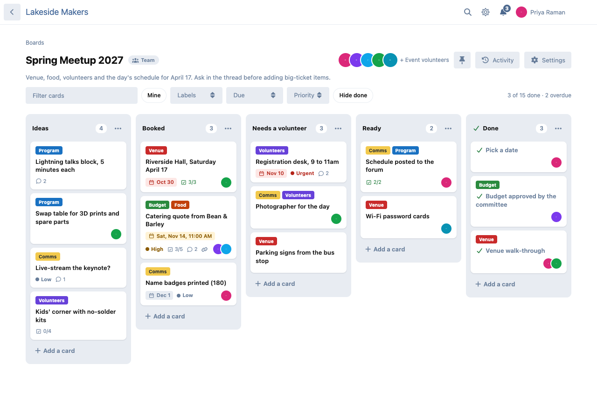
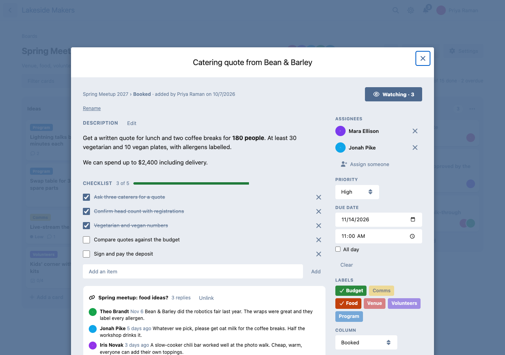
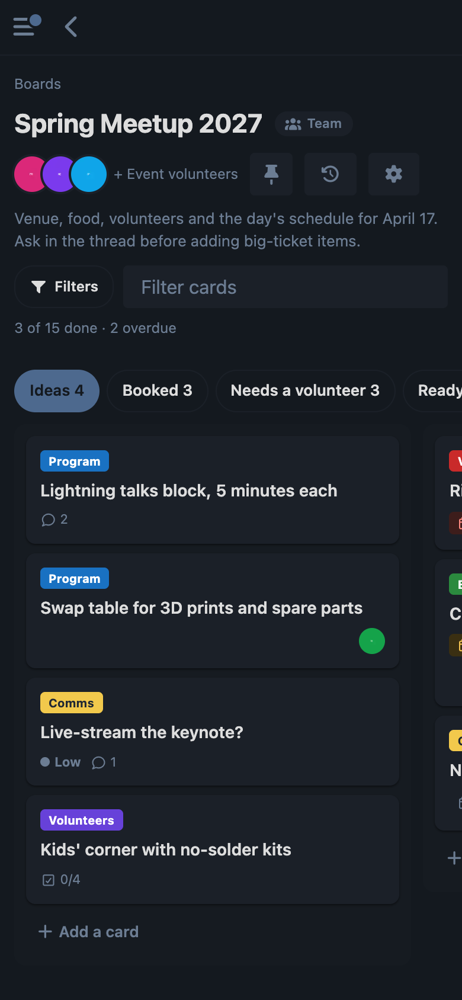
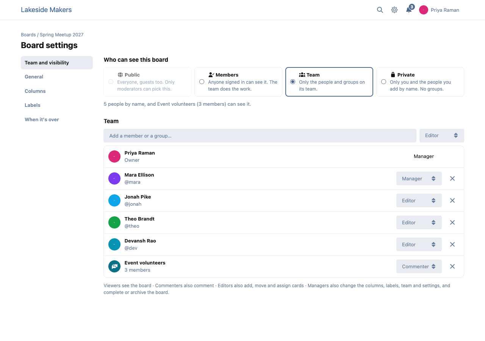

# Corkboard

Project boards inside your Flarum 2 forum. Plan an event, a newsletter, a raid night or a forum move on the forum where the team already talks.



- **Boards with columns and cards.** Each card has a description (Markdown, BBCode and @mentions), a checklist, a priority, a due date, labels, people assigned, comments and a history.
- **Drag and drop by mouse, finger or keyboard.** On a phone the columns swipe one at a time: hold a card to lift it, carry it to the edge to go to the next column, or use **Move…**. With a keyboard, Space picks a card up, the arrow keys carry it, Space drops it and a screen reader is told each step.
- **Who sees what:** each board is **Public** (guests too), **Members** (anyone signed in), **Team** (the people and groups on its team) or **Private** (people by name). Team members are viewers, commenters, editors or managers.
- **Cards and discussions:** link a card to a discussion, or start one from it in the board's tag; the card shows the last replies. Discussions on a board show a chip: "On Spring Meetup 2027 · Booked". Any discussion can be added to a board.
- **Notifications** when you're given a card, a card is due soon or overdue, someone mentions you or comments on a card you watch, a card is finished, or you're added to a team. Emails are batched: a burst of changes is one email.
- **Live:** with flarum/realtime, team members see moves the moment they happen; without it, open boards check every 20 seconds.
- **Templates** (Simple, Event planning, Content calendar, Guild raid prep, and boards moderators save as templates), **clone** a board or a card, **complete** a board (read-only) or **archive** it.
- **My cards** page with a private calendar link (Google, Apple, Outlook) for your due dates.
- **Widgets:** My cards and Due soon for fof/forum-widgets-core (Bespoke shows them in its zones), and My cards, Due soon and Board progress as Page Builder blocks.
- **Works with** ernestdefoe/projects (a project's boards on its page) and ernestdefoe/renown (XP for the people who finish a card, with anti-farming rules).







## Install

```sh
composer require ernestdefoe/corkboard
php flarum migrate
php flarum cache:clear
```

Due-date reminders and the batched emails need Flarum's scheduler (`php flarum schedule:run` every minute from cron).

## Update

```sh
composer update ernestdefoe/corkboard
php flarum migrate
php flarum cache:clear
```

## Permissions

| Permission | Default |
| --- | --- |
| See public and members boards | Everyone |
| Start a board | Members |
| Start a board from a template | Members |
| Make a board public | Moderators |
| See and manage every board | Moderators |

MIT licensed. ☕ [Buy me a coffee](https://buymeacoffee.com/ernestdefoe)
